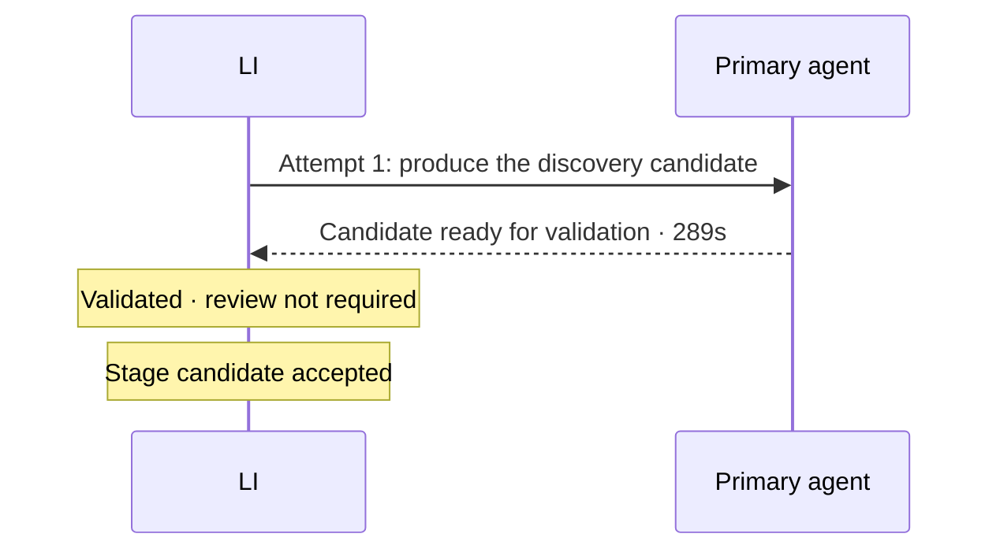
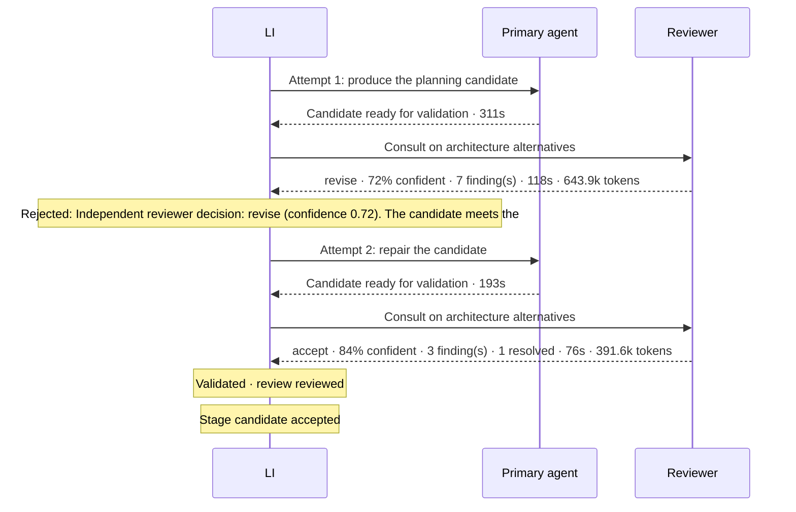
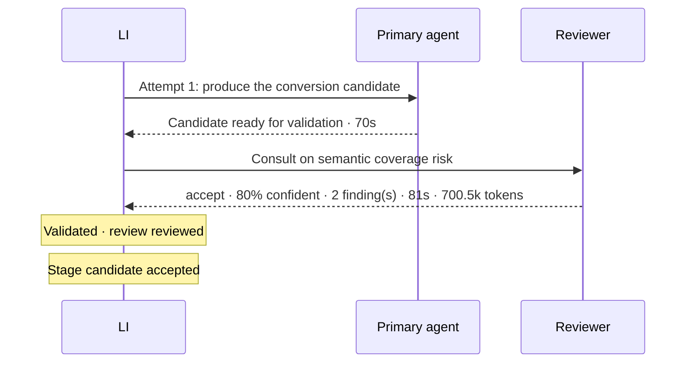

# Agent interactions — HarborLane.Integration

How LI, the primary agent and the independent reviewer worked through each stage: 9 primary-agent turn(s), 3 rejection(s) sent back for repair, 8 reviewer consultation(s).

## Discovery

| Time | From | To | Message | Detail |
| --- | --- | --- | --- | --- |
| 23:30:56 | LI | Primary agent | Attempt 1: produce the discovery candidate |  |
| 23:35:45 | Primary agent | LI | Candidate ready for validation |  |
| 23:35:45 | LI | LI | Validated · review not required |  |
| 23:35:45 | LI | LI | Stage candidate accepted |  |

## Planning

| Time | From | To | Message | Detail |
| --- | --- | --- | --- | --- |
| 23:35:54 | LI | Primary agent | Attempt 1: produce the planning candidate |  |
| 23:41:04 | Primary agent | LI | Candidate ready for validation |  |
| 23:41:05 | LI | Reviewer | Consult on architecture alternatives |  |
| 23:43:03 | Reviewer | LI | revise · 72% confident · 7 finding(s) | Preferred: Revise the candidate in place. Remove strict XSD validation from inside Scope_ProcessOrder and from the shipment pre-processing, keeping XMLReceive-equivalent behaviour; make the Catch_OrderFailure runAfter explicit; and add a gap and gate for the changed Request trigger URL and SAS caller contract. — The candidate meets the hosting, Blob-replacement, network and coverage-contract requirements: pointers and topology are correct, action names are unique, and the source hashes match. It does add schema validation that the source does not show. In order-intake that validation sits inside the catch scope, so a schema-invalid order would produce an OrderError upload that BizTalk would never produce. The guidance is to prefer source-equivalent behaviour when nothing approved supports a deviation, so that one is blocking. The primary agent can fix it within policy, so the decision is revise rather than escalate. The remaining findings are documentation and precision problems, all fixable within policy. |
| 23:43:03 | LI | LI | Rejected: Independent reviewer decision: revise (confidence 0.72). The candidate meets the hosting, Blob-replacement, network and coverage-contract requirement… | Independent reviewer decision: revise (confidence 0.72). The candidate meets the hosting, Blob-replacement, network and coverage-contract requirements: pointers and topology are correct, action names are unique, and the source hashes match. It does add schema validation that the source does not show. In order-intake that validation sits inside the catch scope, so a schema-invalid order would produce an OrderError upload that BizTalk would never produce. The guidance is to prefer source-equivalent behaviour when nothing approved supports a deviation, so that one is blocking. The primary agent can fix it within policy, so the decision is revise rather than escalate. The remaining findings are documentation and precision problems, all fixable within policy. [R1-1] BLOCKING: candidate/order-intake/workflow-order-intake.json:9 adds Validate_PurchaseOrder (XmlValidation against PurchaseOrder.xsd) as a child of Scope_ProcessOrder, and candidate/order-intake/plan.json:9 says this is 'preserving the XMLReceive contract'. In the approved discovery, inputs/approved-discovery/order-intake/components.json:2 lists only Microsoft.BizTalk.DefaultPipelines.XMLReceive, and nothing in the discovery shows schema validation. XMLReceive does not validate against the XSD by default, and a pipeline failure in BizTalk suspends the message before the orchestration starts. Because the candidate puts validation inside the scope, a schema-invalid order would now go through Catch_OrderFailure and upload an OrderError to the errors path, which BizTalk never does. Recommendation: Take strict XSD validation out of Scope_ProcessOrder. Either drop it (XMLReceive only checks well-formedness and resolves message type by root/namespace) or move a message-type check before the scope so that a failure fails the run, the equivalent of a suspend, instead of producing an OrderError. If strict validation is still wanted, record it as an owner-approved deviation in gaps.json and the deployment gates, not as s… |
| 23:43:03 | LI | Primary agent | Attempt 2: repair the candidate | Independent reviewer decision: revise (confidence 0.72). The candidate meets the hosting, Blob-replacement, network and coverage-contract requirements: pointers and topology are correct, action names are unique, and the source hashes match. It does add schema validation that the source does not show. In order-intake that validation sits inside the catch scope, so a schema-invalid order would produce an OrderError upload that BizTalk would never produce. The guidance is to prefer source-equivalent behaviour when nothing approved supports a deviation, so that one is blocking. The primary agent can fix it within policy, so the decision is revise rather than escalate. The remaining findings are documentation and precision problems, all fixable within policy. [R1-1] BLOCKING: candidate/order-intake/workflow-order-intake.json:9 adds Validate_PurchaseOrder (XmlValidation against PurchaseOrder.xsd) as a child of Scope_ProcessOrder, and candidate/order-intake/plan.json:9 says this is 'preserving the XMLReceive contract'. In the approved discovery, inputs/approved-discovery/order-intake/components.json:2 lists only Microsoft.BizTalk.DefaultPipelines.XMLReceive, and nothing in the discovery shows schema validation. XMLReceive does not validate against the XSD by default, and a pipeline failure in BizTalk suspends the message before the orchestration starts. Because the candidate puts validation inside the scope, a schema-invalid order would now go through Catch_OrderFailure and upload an OrderError to the errors path, which BizTalk never does. Recommendation: Take strict XSD validation out of Scope_ProcessOrder. Either drop it (XMLReceive only checks well-formedness and resolves message type by root/namespace) or move a message-type check before the scope so that a failure fails the run, the equivalent of a suspend, instead of producing an OrderError. If strict validation is still wanted, record it as an owner-approved deviation in gaps.json and the deployment gates, not as s… |
| 23:46:16 | Primary agent | LI | Candidate ready for validation |  |
| 23:46:17 | LI | Reviewer | Consult on architecture alternatives |  |
| 23:47:32 | Reviewer | LI | accept · 84% confident · 3 finding(s) · 1 resolved | R1-1 is resolved by the order-intake changes. The same well-formedness and root-QName pattern now also applies to shipment-notification and inventory-update. I also looked at the other changed files for new defects. Shipment-notification now has an explicit 65536-byte JavaScriptCode check with an If, Response and Terminate before XML checking. It documents the callback URL shape and the SAS secret as a high gap (shipment-callback-contract) and a deployment gate, without adding APIM, a custom domain or caller identity, and the fault status stays gated by shipment-fault-contract. Catch_OrderFailure now runs after the concrete action Decide_ApprovalRequired. Inventory-update uses built-in Flat File Decoding. Policy constraints still hold in every changed file: AzureBlob replaces FILE with REPLACE_* container and folder settings, publicNetworkAccess is Enabled, no VNet, private endpoint, APIM or custom domain is planned, retries are 3 at PT5M, and architecture policy is {}. Coverage pointers, sources and hashes are unchanged and consistent with the action names. The settled findings R1-2 to R1-7 have been addressed, and none is reopened. The only problems left are naming inconsistencies in non-coverage mapping files and one stale description, none of which blocks acceptance. |
| 23:47:32 | LI | LI | Validated · review reviewed |  |
| 23:47:32 | LI | LI | Stage candidate accepted |  |

## Conversion

| Time | From | To | Message | Detail |
| --- | --- | --- | --- | --- |
| 00:32:09 | LI | Primary agent | Attempt 1: produce the conversion candidate |  |
| 00:33:18 | Primary agent | LI | Candidate ready for validation |  |
| 00:33:19 | LI | Reviewer | Consult on semantic coverage risk |  |
| 00:34:40 | Reviewer | LI | accept · 80% confident · 2 finding(s) | I checked the candidate against the BizTalk source independently, not only against the plan. All three workflows have one trigger each and are Stateful. MigrationMetadata in each has a valid GUID and date. The maps run as XSLT actions and the flat file is decoded with the source schema. The helper rules are ported one function per source method, using the behavior that discovery recorded from the Helpers .cs files. Branch conditions, catch handling, response ordering and retries match the source. The settled blocking findings (a103c7b3:R1-1, R1-2 and 8d05ce9f:R1-1) are still fixed in the current files: xsltParameters is in place, the Normalize_* payload decoders are in place, and the CSV fixture keeps CRLF line endings. The other settled advisories still apply, and I did not raise them again. The workflows contain no network resources or added approval gates, and I saw no invented constants. The pricing guard for totals of zero or less is a minor point to confirm. It does not block. I found no blocking issue. |
| 00:34:40 | LI | LI | Validated · review reviewed |  |
| 00:34:40 | LI | LI | Stage candidate accepted |  |

