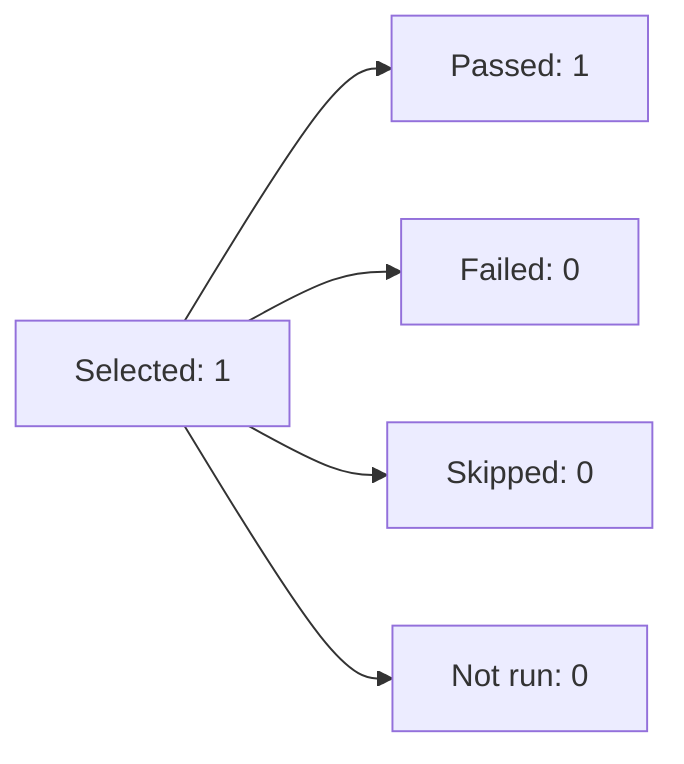
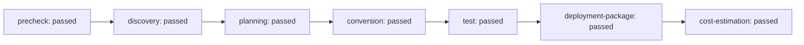

# Migration Batch Report

Started: 2026-10-26T23:30:51.192Z
Completed: 2026-10-27T00:40:30.905Z

**1 passed · 0 failed · 0 skipped**

**Model usage: 32,361,408 tokens · 17 calls · 3674.0 seconds**

| Solution | Calls | Input | Output | Total | Count quality |
| --- | ---: | ---: | ---: | ---: | --- |
| HarborLane.Integration | 17 | 32129157 | 232251 | 32361408 | 17 exact / 0 estimated |
| **Batch total** | **17** | **32129157** | **232251** | **32361408** | **17 exact / 0 estimated** |

Machine-readable report: [JSON](migration-batch-report.json)

## HarborLane.Integration

- **Status:** passed
- **Branch:** migration/harborlane-integration
- **Solution report:** [Open HTML report](solution-report.html)
- **Worktree:** [Open folder](../after)
- **Conversion manifest:** Open report
- **Model usage:** 32,361,408 tokens (32,129,157 input + 232,251 output) across 17 calls
- **Token report:** [Open report](token-usage.md)

| Stage | Status | Model tokens | Report |
| --- | --- | ---: | --- |
| Precheck | passed | 0 | [Open report](precheck-summary.md) |
| Discovery | passed | 1,160,009 | [Open report](stages/discovery/discovery-summary.md) |
| Planning | passed | 3,781,002 | [Open report](stages/planning/planning-summary.md) |
| Conversion | passed | 11,855,491 | [Open report](stages/conversion/conversion-summary.md) |
| Test | passed | 15,564,906 | [Open report](stages/test/test-summary.md) |
| Deployment package | passed | 0 | Open report |
| Cost estimation | passed | 0 | [Open report](azure-cost-estimate.md) |

## Run details

- Selected solutions: 1; not run: 0
- Wall-clock elapsed: 4179.71 s
- Run mode: Full pipeline
- Resume: no; continue on error: yes; concurrency: 1

Passed means the configured stages completed, not proof of orchestration business equivalence. Deployed integration tests and business acceptance remain separate. This batch does not deploy to Azure. Azure infrastructure cost estimates are separate from model token usage and are not invoices.

## Detailed stage outcomes

### HarborLane.Integration

Started: 2026-10-26T23:30:51.217Z; completed: 2026-10-27T00:40:30.544Z; elapsed: 4179.33 s

| Stage | Status | Elapsed | Input | Output | Calls | Exact / estimated calls | Notes |
| --- | --- | ---: | ---: | ---: | ---: | --- | --- |
| precheck | passed | 4.35 s | 0 | 0 | 0 | 0 / 0 |  |
| discovery | passed | 290.24 s | 1142002 | 18007 | 1 | 1 / 0 |  |
| planning | passed | 698.96 s | 3728615 | 52387 | 4 | 4 / 0 |  |
| conversion | passed | 1560.14 s | 11768401 | 87090 | 4 | 4 / 0 |  |
| test | passed | 1358.56 s | 15490139 | 74767 | 8 | 8 / 0 |  |
| deployment-package | passed | 10.11 s | 0 | 0 | 0 | 0 / 0 |  |
| cost-estimation | passed | 246.72 s | 0 | 0 | 0 | 0 / 0 |  |

Source: <sample>

Estimated Azure infrastructure: CAD 276.36/month (canadacentral).
