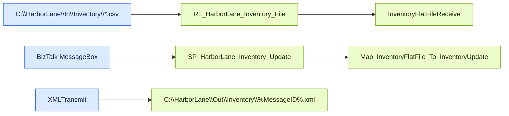

# Inventory Update — Message Flow

Source contract: [messageFlow.json](messageFlow.json)

## Diagram

## Details

| Sequence | From | To | Message | Behavior | Condition |
| --- | --- | --- | --- | --- | --- |
| 1 | C:\HarborLane\In\Inventory\*.csv | RL_HarborLane_Inventory_File | Inventory CSV | FILE adapter polls for CSV files. | _Not specified_ |
| 2 | RL_HarborLane_Inventory_File | InventoryFlatFileReceive | Inventory CSV -> InventoryFlatFile XML | Flat File Disassembler validates structure; HDR and repeating DTL records are comma-delimited and records are CRLF-delimited. | _Not specified_ |
| 3 | BizTalk MessageBox | SP_HarborLane_Inventory_Update | InventoryFlatFile XML | Direct messaging subscription; no orchestration is involved. | BTS.ReceivePortName == RP_HarborLane_Inventory_File |
| 4 | SP_HarborLane_Inventory_Update | Map_InventoryFlatFile_To_InventoryUpdate | InventoryFlatFile -> InventoryUpdate | Outbound map loops over details, copies inventory fields, and formats SnapshotDate. | _Not specified_ |
| 5 | XMLTransmit | C:\HarborLane\Out\Inventory\%MessageID%.xml | InventoryUpdate XML | FILE send port writes mapped XML. | _Not specified_ |
