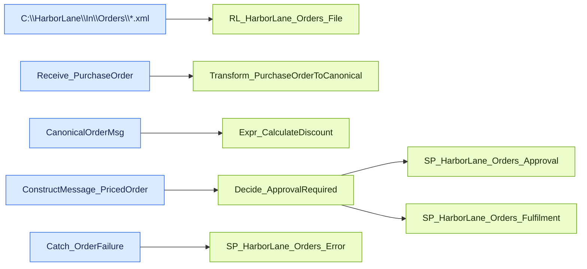

# Order Intake — Message Flow

Source contract: [messageFlow.json](messageFlow.json)

## Diagram

## Details

| Sequence | From | To | Message | Behavior | Condition |
| --- | --- | --- | --- | --- | --- |
| 1 | C:\HarborLane\In\Orders\*.xml | RL_HarborLane_Orders_File | PurchaseOrder | FILE adapter polling through XMLReceive activates Receive_PurchaseOrder. | _Not specified_ |
| 2 | Receive_PurchaseOrder | Transform_PurchaseOrderToCanonical | PurchaseOrder -> CanonicalOrder | Map copies fields and lines, formats the order date, concatenates names/address, and supplies initial values. | _Not specified_ |
| 3 | CanonicalOrderMsg | Expr_CalculateDiscount | CanonicalOrder | CalculateDiscount returns discountAmount; netTotal is OrderTotal minus discountAmount. | _Not specified_ |
| 4 | ConstructMessage_PricedOrder | Decide_ApprovalRequired | CanonicalOrder | Copies the canonical message and assigns DiscountAmount and NetTotal. | _Not specified_ |
| 5 | Decide_ApprovalRequired | SP_HarborLane_Orders_Approval | CanonicalOrder | Writes XML to the approval folder. | OrderTotal >= 5000 |
| 6 | Decide_ApprovalRequired | SP_HarborLane_Orders_Fulfilment | CanonicalOrder | Writes XML to the fulfilment folder. | else |
| 7 | Catch_OrderFailure | SP_HarborLane_Orders_Error | OrderError | BuildOrderError creates an error document and the FILE port writes it to the errors folder. | System.Exception in Scope_ProcessOrder |
