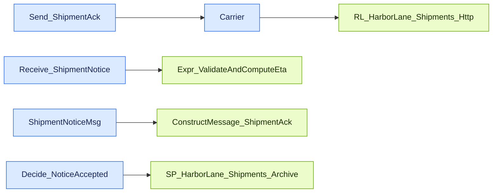

# Shipment Notification — Message Flow

Source contract: [messageFlow.json](messageFlow.json)

## Diagram

## Details

| Sequence | From | To | Message | Behavior | Condition |
| --- | --- | --- | --- | --- | --- |
| 1 | Carrier | RL_HarborLane_Shipments_Http | ShipmentNotice XML | POST /HarborLaneShipments/ShipmentService.svc/notices over transport security with no client credential; XMLReceive activates the orchestration. | _Not specified_ |
| 2 | Receive_ShipmentNotice | Expr_ValidateAndComputeEta | ShipmentNotice | IsValidNotice validates shipment id, tracking number, and package count; EstimateDeliveryDate computes weekend-aware business-day ETA. | _Not specified_ |
| 3 | ShipmentNoticeMsg | ConstructMessage_ShipmentAck | ShipmentNotice -> ShipmentAck | Map copies identifiers and stamps ReceivedAt UTC; AckStatus and calculated ETA overwrite Status and EstimatedDelivery. | _Not specified_ |
| 4 | Send_ShipmentAck | Carrier | ShipmentAck XML | Two-way port returns the response through XMLTransmit before the archive decision. | _Not specified_ |
| 5 | Decide_NoticeAccepted | SP_HarborLane_Shipments_Archive | original ShipmentNotice XML | Writes accepted notices to C:\HarborLane\Out\Shipments\%MessageID%.xml; rejected notices are not archived. | isValid == true |
